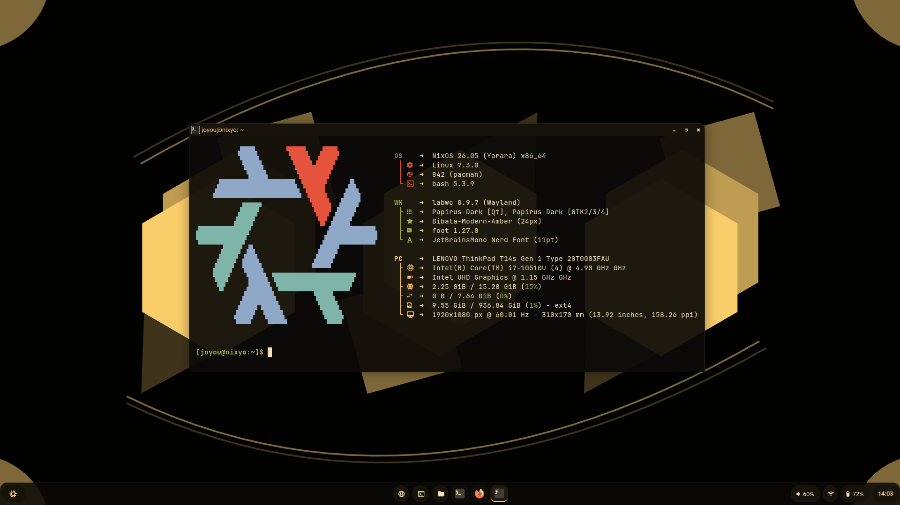

# NixOS + labwc: ChromeOS-style amber rice

A light, keyboard-friendly Wayland desktop that feels like ChromeOS but is more
functional: a launcher, a quick-settings panel, a calendar, notification and
clipboard history, virtual desks and tiling-style snapping. It is built from
small tools (labwc, waybar, rofi, mako, foot) and one colour scheme, ink and amber.

<!-- Replace with your own screenshot: take one with `grim docs/screenshot.png` -->


## Colour scheme

| Role | Colour |
|---|---|
| Ink (background) | `#0B0A08` |
| Surface / raised | `#16120C` / `#221A0E` |
| Border | `#3A2C14` |
| Text | `#F5E1B5` |
| Dim text | `#A8895A` |
| Accent (amber) | `#FFC766` |
| Battery warning / critical | `#FF9F3F` / `#E5533D` |

## What is in it

| Part | Tool |
|---|---|
| Compositor | [labwc](https://github.com/labwc/labwc) with a custom ChromeOS-style theme |
| Bar | waybar, two styles: default (bottom shelf) and floating (islands). Switch with `Super+Shift+W` |
| Launcher, clipboard, panels | rofi (Wayland), three themes in the same palette |
| Notifications | mako, with a volume/brightness OSD, Do Not Disturb and history |
| Terminal | foot |
| Lock / idle | swaylock-effects + swayidle (lock at 5 min, screen off at 10) |
| Power menu | wlogout |
| Theme | adw-gtk3 (dark) + Papirus (yellow folders) + Bibata Amber cursor, Qt via qt5ct/qt6ct + Kvantum |
| Browser | Firefox |

## Features

- **Quick-settings panel** (`Super+S`, or click the status pills): Wi-Fi, Bluetooth, Do Not Disturb, volume, brightness, power profile, notification history and the power menu. Left/Right adjust sliders.
- **Quick-settings panel** (`Super+S`, or click the status pills): Wi-Fi and Bluetooth (press Right to pick a network or device), Do Not Disturb, night light, volume and brightness sliders, power profile, notification history, settings, lock and the power menu.
- **Settings hub** (`Super+I`): one list that opens the right tool for network, Bluetooth, sound, display, appearance, bar style and system info.
- **Calendar**: right-click the clock. Left/Right change month.
- **Notification history** (`Super+N`): Enter copies the text.
- **Clipboard history** (`Super+V`) via cliphist.
- **Virtual desks**: `Super+Tab` cycles, `Super+1..4` jumps.
- **Tiling-style snapping**: halves, corners, master/stack and thirds, all by keyboard.
- **Thumbnail window switcher** on `Alt+Tab`.
- **Power profiles** (power-profiles-daemon) with battery alerts.

## Keybindings

`Super` is the Windows key.

**Apps and panels**

| Keys | Action |
|---|---|
| `Super+Space` | Launcher |
| `Super+E` | File manager |
| `Super+S` | Quick-settings panel |
| `Super+I` | Settings hub |
| `Super+N` | Notification history |
| `Super+V` | Clipboard history |
| `Super+X` | Power menu |
| `Super+L` | Lock screen |
| `Super+Shift+W` | Switch waybar style |
| `Print` / `Shift+Print` or `Super+Shift+S` | Screenshot: full / area |

**Windows**

| Keys | Action |
|---|---|
| `Super+Q` | Close |
| `Super+F` | Fullscreen |
| `Super+M` / `Super+Shift+M` | Maximize / minimize |
| `Super+D` | Hide or show the title bar |
| `Alt+Tab` | Window switcher (thumbnails) |
| `Super+Shift+E` | Exit labwc |

**Desks**

| Keys | Action |
|---|---|
| `Super+Tab` / `Super+Shift+Tab` | Next / previous desk |
| `Super+1` to `Super+4` | Go to desk |
| `Super+Shift+1` to `4` | Send window to desk (stay here) |

**Snapping**

| Keys | Action |
|---|---|
| `Super+Arrows` | Left / right / top / bottom half |
| `Super+Ctrl+Left/Right` | Top-left / top-right corner |
| `Super+Ctrl+Shift+Left/Right` | Bottom-left / bottom-right corner |
| `Super+Alt+Left` | Master column (left 60%) |
| `Super+Alt+Right` | Stack column (right 40%) |
| `Super+Alt+Up/Down` | Top / bottom half of the stack |
| `Super+Alt+1/2/3` | Left / middle / right third |

Holding Super while dragging a window also snaps it to these regions.

## Repository layout

```
nixos/configuration.nix   system config (packages, theming via dconf, services)
home/                     hand-written config, mirrors $HOME (symlinked by link.sh)
scripts/                  setup scripts that generate the rest (GTK css, Qt, rofi themes, panel scripts)
link.sh                   symlinks home/ into $HOME
```

The setup scripts generate the GTK CSS, Qt palettes, rofi themes and the panel
scripts (`qs-panel`, `notif-history`, `calendar-popup`), so those are not stored
in the repo.

## Install on NixOS

1. Install NixOS (a minimal install is enough).
2. `nix-shell -p git`, then `git clone <this repo> ~/dotfiles`.
3. Keep the new machine's own `/etc/nixos/hardware-configuration.nix`. Copy
   `nixos/configuration.nix` over `/etc/nixos/configuration.nix`, then **set your
   username, hostname and bootloader** in it.
4. `sudo nixos-rebuild switch`
5. `~/dotfiles/link.sh`
6. Generate the rest:

   ```bash
   bash ~/dotfiles/scripts/rofi-setup.sh
   bash ~/dotfiles/scripts/qs-setup.sh
   bash ~/dotfiles/scripts/amber-theme-setup.sh
   ```

7. Add `polkit-agent &` and `poweralertd &` to `~/.config/labwc/autostart` if they are not there, then log in to labwc.
8. Sign in to Firefox Sync for your theme extension and settings.

The lock screen image is made from the wallpaper:
`nix-shell -p imagemagick --run "bash ~/dotfiles/scripts/make-lock.sh"`.

## Install on other distros

Arch, Fedora, Debian/Ubuntu and openSUSE are supported on a best-effort basis:

```bash
git clone <this repo> ~/dotfiles
DRY_RUN=1 bash ~/dotfiles/scripts/distro-bootstrap.sh   # preview
bash ~/dotfiles/scripts/distro-bootstrap.sh
```

It installs what your repositories have, applies the settings `configuration.nix`
declares on NixOS, links the configs, runs the setup scripts and lists anything it
could not find. Needs **labwc 0.9 or newer** (thumbnail Alt+Tab) and a rofi build
with Wayland support.

## Things that depend on the machine

- **Screen size.** The Network settings popup position (`windowRules` in `rc.xml`) and the rofi `y-offset` values assume 1920×1080 with a 48px bar.
- **Lock screen path.** If the image does not show, set an absolute path in `~/.config/swaylock/config`.
- **Hardware.** `hardware-configuration.nix` is not in the repo. The Bluetooth and brightness rows only appear when the hardware exists.

## Day to day

Files in `~` are symlinks into `home/`, so edit them normally, then:

```bash
cd ~/dotfiles && git add -A && git commit -m "..." && git push
```

After changing the system config, copy the changes into `nixos/configuration.nix` by hand.

## Notes

The wallpaper and lock image are my own work. Everything else is configuration; reuse
whatever is useful.
